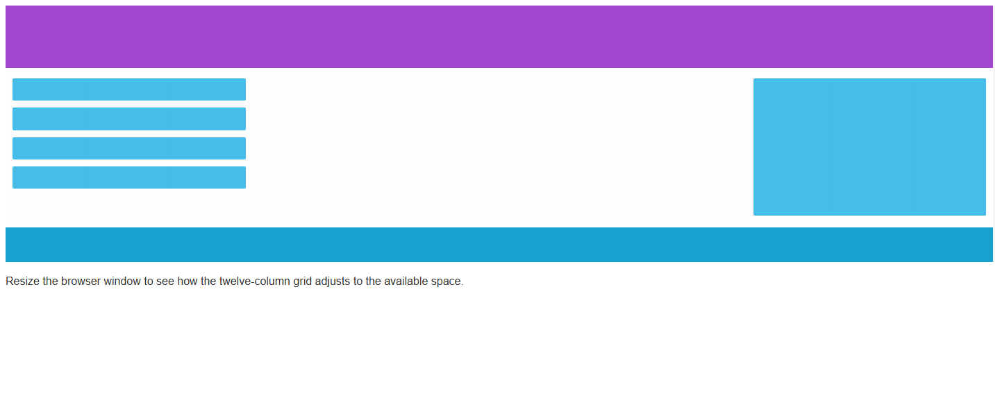
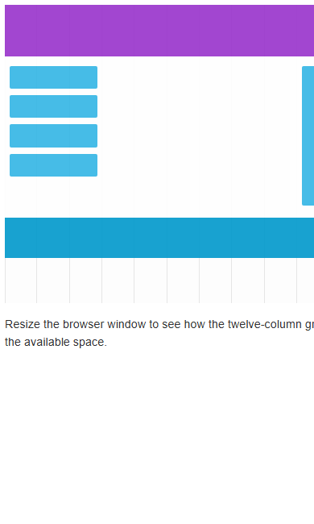

# Responsive Grid — Sass Refactor

This exercise refactors the supplied [CodeGym responsive-grid](https://github.com/codegym-vn/responsive-grid) example. Inline and embedded layout styles have been moved into Sass, while the original twelve-column page composition, header, navigation blocks, content area, sidebar, footer, and guide grid are preserved.

## Sass concepts used

- Variables for colors, grid columns, row heights, and spacing.
- A mixin to generate consistent twelve-column grid rows.
- A map and `@each` loop to generate reusable column-span classes.
- Nested selectors and a media query for the compact layout.

## Build

Install Sass if needed, then compile the source:

```sh
npm install --save-dev sass
npx sass scss/style.scss style.css
```

Open `index.html` in a browser and resize the window to inspect the layout.

## Screenshots

### Desktop



### Mobile


